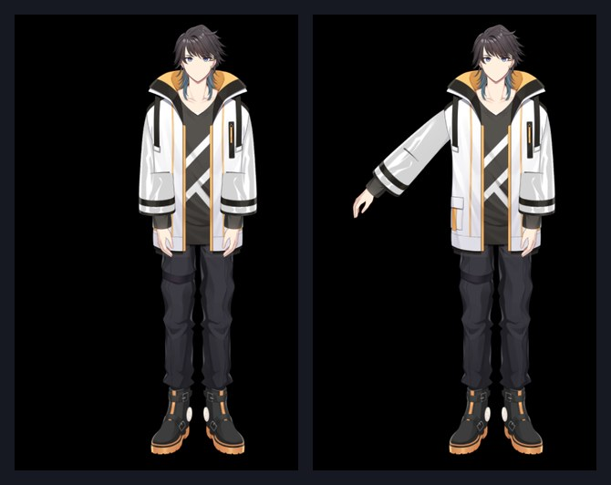

# Live2D Cubism — 움직이는 2D 캐릭터

Live2D Cubism은 Live2D 모델을 게임으로 가져옵니다: 숨 쉬고, 깜빡이고, 한 점을 바라보고, 물리(머리카락, 옷)로 움직이며, 작가가 만든 모션과 표정을 재생하는 그려진 캐릭터입니다. C#용 Cubism 런타임과 그 네이티브 코어 라이브러리가 들어 있고, 다른 mod들이 이것으로 장면에 모델을 표시합니다.

Cthangover 게임의 선택 블록입니다. 지금의 스토리 콘텐츠는 여전히 정지 초상화를 쓰고, 내장 게임 중 Live2D 모델을 실은 것은 아직 없습니다. 이 mod의 자체 데모가 동작하는 모델을 보여 줍니다.



## 모델이 할 수 있는 것

- **대기 중의 생기** — 자동 깜빡임(기본 켜짐)과 호흡(기본 꺼짐).
- **물리** — 머리카락과 옷이 모델의 `physics3.json`에 따라 흔들립니다.
- **시선** — 머리와 눈이 목표점을 향합니다. 데모에서는 캐릭터 위에서 마우스를 끌어 시선을 이끌 수 있습니다.
- **모션과 표정** — 모델에 정의된 그룹(`mtn_01`…)의 모션을 재생하거나 표정(`exp_01`…)을 설정합니다.
- **파라미터** — 모델의 어떤 파라미터든 직접 설정합니다. 위 그림은 파라미터 하나로 오른팔을 든 모습입니다.
- **배치** — 모델이 자기 영역에 자동으로 맞춰지거나, 주어진 위치와 배율로 놓입니다.

## 모델 요건

모델은 Cubism 표준 내보내기 폴더로, mod 안에 둡니다:

```filestree
my_mod/
└── models/
    └── runtime/
        ├── ren.model3.json       가리킬 진입 파일
        ├── ren.moc3
        ├── ren.physics3.json
        ├── ren.cdi3.json
        ├── ren.4096/texture_00.png
        ├── expressions/exp_01.exp3.json …
        └── motions/mtn_01.motion3.json …
```

- 모델은 Cubism 모델(`model3.json`이 있는 `.moc3`)입니다. 데모 모델은 Cubism 5.3으로 만들어졌고 그 마스크와 오프스크린 그리기를 사용합니다.
- 네이티브 Cubism 코어가 Windows(`.dll`)와 Linux(`.so`)용으로 포함되어 있습니다.
- 예시 모델에는 Live2D 자체 라이선스가 따릅니다. 공개하기 전에 모델의 `ReadMe.txt`를 읽어 보세요.

## 시나리오에서 모델 표시하기

`add_live2d_model` 액션이 모델을 장면의 뷰에 넣습니다:

```scenario
action add_live2d_model model_path=models/runtime/ren.model3.json mod_id=my_mod node_name=Ren x=960 y=540 scale=0.5
```

- `model_path` — `model3.json`, mod 폴더 기준 상대 경로.
- `mod_id` — 그것을 담고 있는 mod.
- `node_name` — 장면에서 이 모델의 이름(같은 이름의 두 번째 액션은 무시됩니다).
- `x`, `y`, `scale` — 선택 사항인 위치와 크기. 없으면 모델이 자동으로 맞춰집니다.

코드가 있는 mod는 `Live2DService.CreateModel(...)`로 모델을 만들고, `StartMotion(group, number)`, `StartExpression(id)`, `SetLiveParameter(id, value)`, `SetTargetPoint(x, y)`를 호출할 수 있습니다.

## 데모

이 mod의 **avatar** 테스트 스위트에 예시 모델 Ren이 들어 있습니다. 켜면 Ren이 Cthangover의 빌라 밖에 나타나 마우스 끌기를 따라갑니다. 자동 검사는 오른팔을 올리고 프레임을 비교합니다. 개발자용 데모이고 일반 플레이에서는 꺼져 있습니다.

## 문제가 생겼을 때

1. **모델이 없는데 로그에 `model_path`나 mod 이야기가 나옵니다.** 경로는 mod 폴더 기준이며 `model3.json`을 가리켜야 합니다. `mod_id`는 그것을 가진 mod의 id여야 합니다.
2. **모델이 엉뚱한 위치나 크기로 나옵니다.** `x`, `y`, `scale`을 주거나, 셋 다 생략해 자동 맞춤에 맡기세요.
3. **어떤 플랫폼에서 모델이 로드되지 않습니다.** Cubism 코어 라이브러리는 Windows와 Linux용만 제공됩니다.
